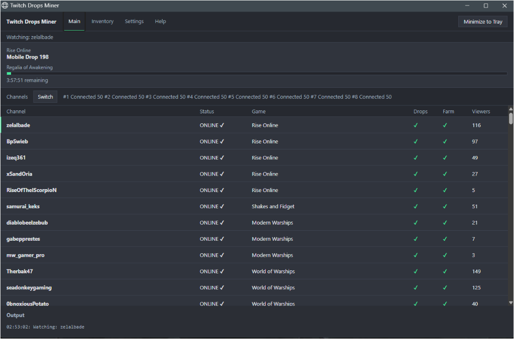
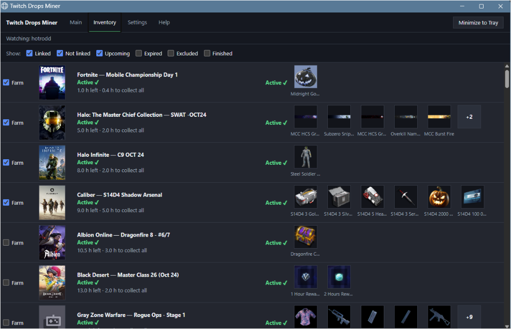
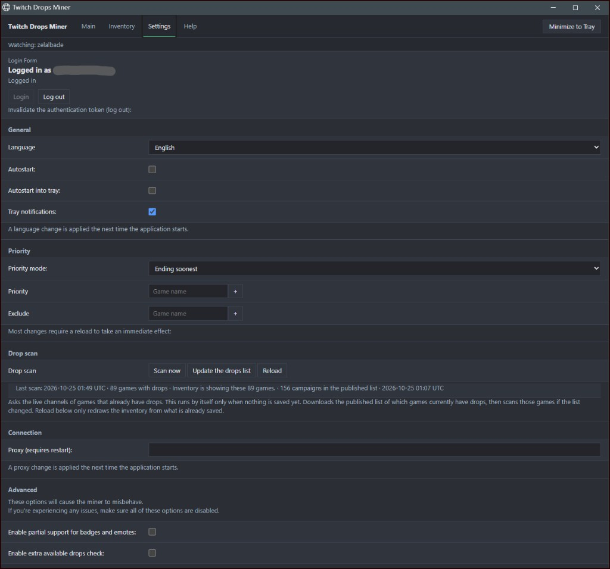
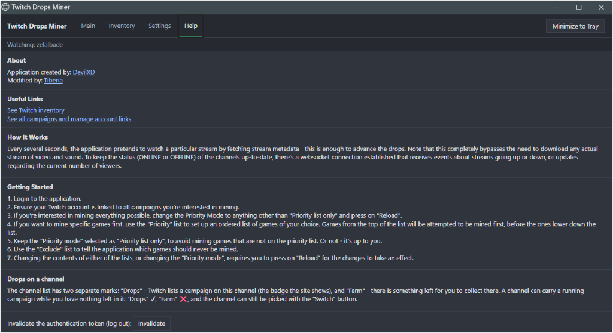

# Twitch Drops Miner

Desktop program that collects timed Twitch drops. The mining loop comes from [DevilXD/TwitchDropsMiner](https://github.com/DevilXD/TwitchDropsMiner). This copy keeps that loop and puts Main, Inventory, Settings and Help in one window.

Maintained by [Tiberia](https://github.com/Tiberius1OOO/TwitchDropsMiner). Current release: 16.2.6.

## Main



The top bar is the same on every page. Main shows the game and the campaign being collected. A campaign with one drop uses one progress bar. A campaign with several drops uses two: the campaign, and the drop being collected now. The channel being watched has a green mark on the left. Switch moves the miner to the channel you click.

## Inventory



Every campaign is one row of the same height. The order follows the priority mode. Ending soonest puts the campaign that ends first at the top.

- The row shows the time still left and the time needed to collect every reward.
- A claimed reward is gray, with a green check. The reward being collected has a blue outline. Rewards still ahead stay as they are.
- Farm marks games you want first. With no box ticked, the games on screen are all eligible.
- Show filters include a group. They do not change the order.
- A campaign is mined even when the game account is not linked. The drop stays in your Twitch inventory until the claim date, and the game can be linked later.

## Settings



The account is at the top: the Twitch name you are logged in with, Login, and Log out. When Twitch asks for a device code, that code is shown on this page. Press Login to open the Twitch page, then enter the code.

- General: language, autostart, tray, notifications.
- Priority: the mode, the priority list, and the exclude list. Ending soonest does not let the priority list jump the queue. That list applies in Priority only. Changing the mode sorts the inventory again and picks the next channel.
- Drop scan: Scan now, Update the drops list, and Reload. The known list is fetched once when nothing is saved yet. It is not scanned again on a timer.
- Connection: the proxy. A proxy or language change applies on the next start.
- Advanced: options that can make the miner misbehave. Leave them off unless you need them.

## Help



Help explains how watch time is counted, and links to the Twitch inventory and the campaign page.

## How a campaign is chosen

Ending soonest compares how long the campaign has left with how long it takes to collect every drop.

Spare time is the time left minus the time needed. If that spare time is above 0 and at most 30 minutes, that campaign is watched now. If several campaigns are in that window, the game with more viewers is watched.

A campaign that cannot be finished in the time left stays in the list, and it is not chosen over one that can still be finished.

## How a drop advances

Every few seconds the program requests stream metadata for the channel it is watching. Twitch counts that as watch time. The video and the audio are not downloaded. A websocket keeps each channel online or offline, and keeps the viewer count current.

Login is stored in `cookies.jar` next to the program. That file is your Twitch login, so keep it private.

Watching another stream in a browser with the same account at the same time makes Twitch report progress that does not match this program.

## Run on Windows

The Windows build is attached to the [16.2.6 release](https://github.com/Tiberius1OOO/TwitchDropsMiner/releases/tag/v16.2.6). Unpack it and start `Twitch Drops Miner.exe`.

1. Open Settings and press Login. The code is shown on that page.
2. The miner starts on the campaign that fits the priority mode. Linking a game account can wait until you want the drop inside the game.
3. Tick Farm on Inventory when you want those games first.
4. Minimize to Tray leaves the miner running with the window hidden.

## Build

Python 3.11 and the packages in `requirements.txt`.

```
python -m PyInstaller --noconfirm build.spec
```

The executable is written to `dist`.

## Credit

The application was created by [DevilXD](https://github.com/DevilXD/TwitchDropsMiner). This repository is maintained by [Tiberia](https://github.com/Tiberius1OOO/TwitchDropsMiner).
